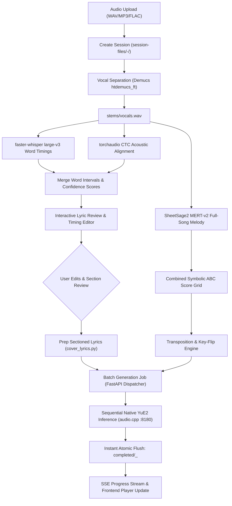

# Cover Studio — Technical Specification

Cover Studio is a local-first, one-click AI song cover generation studio built on **YuE2-3B**, **audio.cpp**, **SheetSage2**, and **faster-whisper**. It transforms source audio recordings into fully arranged, style-transformed vocal and instrumental covers while preserving source melody, lyrical cadence, and phrasing structure.

---

## 1. System Architecture

Cover Studio employs a decoupled multi-process architecture to isolate heavy machine learning dependencies (PyTorch, transformers, CUDA/Vulkan runtimes) and prevent Python dependency conflicts (specifically SheetSage2's dependency on `transformers==4.45.2` versus newer HuggingFace libraries).

```
┌────────────────────────────────────────────────────────────────────────┐
│                        Web Browser Client                              │
│              (Vanilla HTML5 / Modern CSS / ES6+ JS)                    │
│    • Session Selector        • Waveform Player    • Timed Lyrics Grid  │
│    • Style Matrix Multi-pick • Live VRAM Gauge    • EventSource SSE    │
└───────────────────────────────────┬────────────────────────────────────┘
                                    │ HTTP / SSE (:8420)
┌───────────────────────────────────▼────────────────────────────────────┐
│                    FastAPI Host Application (app/server.py)             │
│    • Session Store & Disk Cache     • Background Job Dispatcher         │
│    • Style Preset CRUD Engine       • SSE Telemetry Broadcast           │
│    • nvidia-smi VRAM Monitor        • Direct File Serving (/completed)  │
└───────┬───────────────────────────┬────────────────────────────┬───────┘
        │ Subprocess / IPC          │ In-Process (PyTorch CPU)   │ HTTP REST (:8180)
┌───────▼───────────────┐  ┌────────▼──────────────────┐ ┌───────▼──────────────┐
│  .venv-demucs Worker  │  │   SheetSage2 Engine       │ │   audio.cpp Server   │
│ (htdemucs_ft Stems)   │  │ (MERT-v2 Full-Song Score) │ │ (Native C++ YuE2)    │
│ • Isolated PyTorch    │  │ • Monophonic Vocal Track  │ │ • Vulkan / CUDA      │
│ • Vocal Stem Extract  │  │ • Combined Score Grid     │ │ • Qwen3-ASR fallback │
│ • Non-destructive Log │  │ • Major/Minor Key Flip    │ │ • GGUF Weight Engine │
└───────────────────────┘  └───────────────────────────┘ └──────────────────────┘
        │
┌───────▼───────────────┐
│ .venv-whisper Aligner │
│ • faster-whisper v3   │
│ • Wav2Vec2 CTC Aligner│
│ • Word-level Timings  │
└───────────────────────┘
```

### Core Subsystems

1. **FastAPI Application (`app/server.py`)**: Host HTTP daemon (`127.0.0.1:8420` or `0.0.0.0:8420`) handling request coordination, persistent session management, Server-Sent Events (SSE) telemetry, and orchestration across background workers.
2. **Native Inference Daemon (`audiocpp_server`)**: High-performance C++ inference engine listening on `127.0.0.1:8180`. Executes YuE2-3B generation via Vulkan or CUDA using quantised GGUF weights. Patched with RoPE buffer alignment and batched COL2IM dispatch fixes.
3. **Vocal Stem Separation (`app/vocal_separation.py`)**: Spawns an isolated Python 3.12 subprocess (`.venv-demucs`) running Meta's `htdemucs_ft`. Extracts clean vocals (`stems/vocals.wav`) without polluting SheetSage2's dependency tree.
4. **Whisper & CTC Forced Aligner (`app/whisper_transcribe.py`)**: Executes `faster-whisper large-v3` on untrimmed vocal stems to extract raw word intervals, followed by torchaudio's `WAV2VEC2_ASR_BASE_960H` CTC acoustic forced alignment to tighten syllable and word boundaries.
5. **SheetSage2 Symbolic Transcriber (`app/sheetsage2_transcribe.py`)**: In-process PyTorch model utilizing MERT-v2 representations to extract monophonic vocal melodies and chord sequences into ABC notation format.
6. **Lyric & Score Formatter (`app/cover_lyrics.py`, `app/score_grid.py`)**: Aligns transcribed lyrics with structural musical sections (`[Verse]`, `[Chorus]`, `[Bridge]`), bounds pickup phrases across section markers, preserves short musical notes from quantization collapse, and enforces syllable-to-score harmony.

---

## 2. End-to-End Processing Pipeline



### Stage 1: Ingestion & Session Initialization (`POST /api/covers/prepare`)
- Uploaded audio files are transcoded to uncompressed 16-bit 44.1/48 kHz WAV format.
- A persistent directory is allocated under `session-files/<sanitized-song-name>-<short-uuid>/`.
- Session state is initialized in `session.json` with `ready: false`.

### Stage 2: Stems & Acoustic Separation (`app/vocal_separation.py`)
- Executes `tools/separate_vocals.py` in the `.venv-demucs` virtual environment.
- Configurable acceleration via `DEMUCS_DEVICE` (defaults to CPU, supports CUDA).
- Generates `stems/vocals.wav` and non-destructive execution logs in `stems/demucs.log`.
- Fast path: If `stems/vocals.wav` exists and is non-empty (>44 bytes), separation is skipped on rerun.

### Stage 3: Lyrical Transcription & Acoustic Alignment (`app/whisper_transcribe.py`)
1. **ASR Pass**: `faster-whisper` large-v3 processes the untrimmed vocal stem, returning full text and initial word-level boundary estimates `(start, end, confidence)`.
2. **CTC Acoustic Alignment Pass**: Torchaudio's `WAV2VEC2_ASR_BASE_960H` model consumes `stems/vocals.wav` and the recognized tokens. It computes the acoustic frame emissions and calculates refined token alignments.
3. **Refinement & Review Gating**: Adjustments exceeding maximum allowable shift thresholds or scoring low alignment confidence retain original boundaries and are flagged for user review. Results are written to `lyrics-whisper-large-v3.json` and `lyrics-aligned-<hash>.json`.

### Stage 4: Melody Transcription & ABC Score Generation (`app/sheetsage2_transcribe.py`, `app/score_grid.py`)
- SheetSage2 and MERT-v2 evaluate both vocal stem and instrumental context.
- Generates:
  - `melody_notes.json`: Monophonic pitch series `(start, end, midi_pitch)`.
  - `scores/direct-song/structure.lab`: Musical form segmentation (`intro`, `verse`, `chorus`, etc.).
  - `scores/direct-song/score.abc`: Full ABC notation score.
- **Quantization Protection (`app/score_grid.py`)**: `fit_note_intervals` fits ordered notes into notation grid cells without dropping short passing notes or collapsing microtonal ornamentations.

### Stage 5: Score Conditioning & Section Assembly (`app/cover_lyrics.py`)
- Automatically inserts structural tags (`[Intro]`, `[Verse]`, `[Chorus]`, `[Bridge]`, `[Outro]`) into the lyrics text based on `structure.lab`.
- **Pickup Phrase Preservation**: Prevents vocal pickup lines from being marooned in preceding instrumental or short intro sections by sliding phrase boundaries across segment edges.
- Supports **Manual Section Override**: If the user provides explicit tags (`[Verse]`, `[Chorus]`), automatic structural splitting yields to user formatting while maintaining word interval associations.

### Stage 6: Batch Generation & Live Stream (`POST /api/covers/{session_id}/generate`)
- Generates covers sequentially across selected style presets.
- Submits structured payloads to `audiocpp_server` (`/v1/tasks/run`).
- Broadcasts real-time generation tokens, elapsed time, and style progress over SSE (`/api/covers/{batch_id}/events`).
- **Immediate Write-on-Finish**: Each finished style take is flushed to `completed/<song>_<style>_<hash>.wav` immediately. A browser reload or subsequent style crash does not compromise already rendered tracks.

---

## 3. Session Storage & Persistence Specification

All artifacts are persisted under `SESSION_FILES_DIR` (defaults to `session-files/`):

```
session-files/
└── Bohemian_Rhapsody-4f81c9/
    ├── original.wav                      # Uploaded source audio
    ├── session.json                      # Atomic state manifest
    ├── lyrics-history.jsonl              # Append-only edit history
    ├── lyrics-whisper-large-v3.json      # Raw Whisper transcription + word timings
    ├── lyrics-aligned-a1b2c3d4.json      # CTC acoustically-aligned word timings
    ├── stems/
    │   ├── vocals.wav                    # Demucs isolated vocal stem
    │   └── demucs.log                    # Separation stdout/stderr diagnostic log
    └── scores/
        └── direct-song/
            ├── melody_notes.json         # Raw SheetSage2 note intervals and pitches
            ├── structure.lab             # Section boundaries (start, end, label)
            └── score.abc                 # Compiled ABC notation score
```

### `session.json` Schema

```json
{
  "id": "4f81c9a2-9b21-4f11-9a74-123456789abc",
  "source_name": "Bohemian Rhapsody.mp3",
  "source_path": "original.wav",
  "vocals_path": "stems/vocals.wav",
  "ready": true,
  "error": null,
  "created_at": 1727500000.123,
  "lyrics": "[Verse]\nIs this the real life?...",
  "lyrics_reviewed": true,
  "melody": {
    "key": "Bb",
    "meter": "4/4",
    "bpm": 72.0,
    "has_vocals": true
  },
  "transcription": {
    "text": "Is this the real life...",
    "words": [
      {
        "text": "Is",
        "start": 0.84,
        "end": 1.02,
        "confidence": 0.94,
        "pitch_matches": [58]
      }
    ]
  },
  "generations": [
    {
      "batch_id": "8f12a34c",
      "style_id": "synthwave_80s",
      "style_label": "80s Synthwave",
      "filename": "Bohemian_Rhapsody_synthwave_80s_8f12a34c.wav",
      "created_at": 1727500500.0,
      "seed": 42
    }
  ],
  "pipeline_version": 1
}
```

### Atomic File Operations
To eliminate data corruption during power loss or system crashes:
- Writes are staged to `.session-<uuid>.tmp`.
- Flushed and synchronized using `os.replace` (POSIX atomic rename; atomic on Windows NTFS).
- Retains old state files in backup rotation if validation fails.

---

## 4. Native Engine Integration (`audio.cpp`)

YuE2-3B runs natively using the high-performance C++ runtime `audio.cpp`.

### Engine Configuration (`server.json`)

```json
{
  "host": "127.0.0.1",
  "port": 8180,
  "device": 0,
  "backend": "vulkan",
  "models": {
    "yue2_ar": "models/yue2/yue2-ar-3b-q4_k_m.gguf",
    "yue2_nar": "models/yue2/yue2-nar-3b-q4_k_m.gguf",
    "qwen_asr": "models/qwen3_asr/qwen3-asr-q8_0.gguf"
  }
}
```

### Critical Engine Patches (Maintained in `pkircher29/audio.cpp:cover-studio`)

1. **Sliced RoPE Position View Materialization (`src/framework/modules/positional_modules.cpp`)**:
   - *Problem*: In YuE2's batched classifier-free guidance (CFG), row 1 begins 4 bytes into the parent buffer (`view_offs != 0`). Vulkan RoPE compute pipelines require storage-buffer bindings aligned to physical GPU page strides.
   - *Fix*: Detects `ctx.backend_type == BackendType::Vulkan && position_tensor->view_offs != 0` and invokes `ggml_cont` to copy the slice into an aligned scratch allocation before invoking `ggml_rope_ext`.
2. **COL2IM 1D Tensor Dispatch Boundary (`external/ggml/src/ggml-vulkan/ggml-vulkan.cpp`)**:
   - *Problem*: Long stereo audio tensors generated during YuE2 decoding exceeded the maximum Vulkan compute workgroup X dimension limit (`65535`), resulting in hardware driver aborts.
   - *Fix*: Clamps dispatch elements to `limits.maxComputeWorkGroupCount[0] * pipeline->wg_denoms[0]` and leverages the shader's internal grid-stride loop to process remainder samples.

### API Request Schema (`POST /v1/tasks/run` on `:8180`)

```json
{
  "task": "music_generation",
  "lyrics": "[Verse]\nWords to sing...",
  "seed": 1337,
  "num_inference_steps": 4,
  "options": {
    "style": "[Genre: Synthwave] [Tempo: 110 BPM] [Rhythm Section: Linndrum 80s gated snare] ...",
    "cot": "generate a lush analog synth intro with soaring lead guitar",
    "abc": "X:1\nM:4/4\nL:1/8\nK:C\n|: C2 E2 G2 c2 :|",
    "cfg_scale": 4.5,
    "flip_key": false,
    "vocal": "Female"
  }
}
```

---

## 5. Style Preset Architecture

Styles are defined in `app/styles.json` and are fully editable at runtime. Each style prompt uses explicit bracketed tokens to guide YuE2's Autoregressive (AR) and Non-Autoregressive (NAR) stages:

```json
{
  "id": "prog_rock",
  "label": "Prog Rock",
  "prompt": "[Genre: Late 1970s–Early 1980s Progressive Rock / Heavy Virtuosic Art Rock]\n[Tempo: 120–144 BPM with frequent, seamless metric modulation and tempo shifts]\n[Time Signature: Constant shifting odd meters: alternating 7/8, 5/4, 6/8, and 4/4; polyrhythmic interplay]\n\n[Rhythm Section & Clockwork Precision]:\n- Drums: Massive, complex acoustic percussion battery (Neil Peart style); double-bass drum setup with rapid-fire, melodic 16th-note fills...\n- Bass Engine: Rickenbacker 4001 through bi-amped rig...\n\n[Guitars & Sonic Textures]:\n- Guitars: Gibson ES-355 through clean Hiwatt or Marshall tube stacks...\n\n[Vocals & Performance]:\n- Lead Vocals: High-register, operatic rock tenor (Geddy Lee style)..."
}
```

### Style Management Endpoints
- `GET /api/styles`: Returns light summary list `[{id, label}]`.
- `GET /api/styles/full`: Returns full configurations including prompt bodies.
- `POST /api/styles`: Creates a new style preset.
- `PUT /api/styles/{id}`: Updates an existing style prompt or label.
- `DELETE /api/styles/{id}`: Deletes a user preset (built-ins are protected).

---

## 6. HTTP API Specification

### Hardware Diagnostics
#### `GET /api/gpu/vram`
Inspects NVIDIA GPU memory via `nvidia-smi` across dynamic Windows DriverStore paths.
- **Response (200 OK)**:
  ```json
  {
    "available": true,
    "name": "NVIDIA GeForce RTX 4070 Ti",
    "used_mib": 3412,
    "total_mib": 12288
  }
  ```
- *Note*: If Vulkan or non-NVIDIA GPUs (e.g. Intel Arc B580) are active, returns `{"available": false}`.

#### `GET /api/health`
Monitors health of both FastAPI and `audiocpp_server`.
- **Response (200 OK)**:
  ```json
  {
    "ok": true,
    "yue2_loaded": true,
    "backend": "vulkan",
    "device": "Intel(R) Arc(TM) B580 Graphics",
    "models": ["yue2-ar-3b-q4_k_m.gguf", "yue2-nar-3b-q4_k_m.gguf"]
  }
  ```

### Session & Audio Preparation
#### `POST /api/covers/prepare`
Uploads source audio and launches the preparation pipeline (Demucs + Whisper + SheetSage2).
- **Body**: `multipart/form-data` with `file: UploadFile`.
- **Response (200 OK)**: `{"session_id": "...", "job_id": "..."}`.

#### `GET /api/sessions`
Lists all persisted song sessions sorted by creation timestamp.
- **Response (200 OK)**: `{"sessions": [{"id": "...", "source_name": "...", "ready": true, "created_at": 1727500000.0}]}`.

#### `GET /api/sessions/{session_id}`
Returns complete session manifest including lyrics, word timings, and completed generations.

#### `PUT /api/sessions/{session_id}/lyrics`
Saves corrected lyrics text. If word counts match existing transcription, retains existing word intervals and attaches `text_edited: true` flags.
- **Body**: `{"lyrics": "string"}`.

#### `POST /api/sessions/{session_id}/tighten-timing`
Executes secondary CTC acoustic forced alignment on the existing transcript without re-running separation or full ASR.

### Generation & Output Management
#### `POST /api/covers/{session_id}/generate`
Initiates cover creation across one or more styles.
- **Form Parameters**:
  - `lyrics` (string): Final reviewed lyrics (with optional `[Verse]` / `[Chorus]` markers).
  - `styles` (JSON array): List of style IDs, e.g. `["synthwave_80s", "prog_rock"]`.
  - `seed` (int, default: -1): RNG seed (-1 for random).
  - `num_inference_steps` (int, default: 4): NAR diffusion steps.
  - `flip_key` (bool, default: false): Shifts ABC score key signature between major and relative minor.
  - `vocal` (string, default: "Any"): Gender guidance ("Any", "Male", "Female").
- **Response (200 OK)**: `{"batch_id": "...", "status": "running"}`.

#### `GET /api/covers/{batch_id}/events`
Server-Sent Events (SSE) telemetry stream reporting generation status.
- **Event Data**:
  ```json
  {
    "batch_id": "8f12a34c",
    "status": "processing",
    "stage": "Generating 80s Synthwave (1/2)",
    "elapsed_s": 14.2,
    "engine_active": true,
    "styles": [
      {
        "id": "synthwave_80s",
        "label": "80s Synthwave",
        "status": "done",
        "filename": "Song_synthwave_80s_8f12a34c.wav",
        "error": null
      },
      {
        "id": "prog_rock",
        "label": "Prog Rock",
        "status": "running",
        "filename": null,
        "error": null
      }
    ]
  }
  ```

#### `GET /api/completed`
Enumerates all finished audio files in the `completed/` directory.
- **Response (200 OK)**:
  ```json
  {
    "files": [
      {
        "filename": "Bohemian_Rhapsody_synthwave_80s_8f12a34c.wav",
        "size_bytes": 15843210,
        "created_at": 1727500500.0
      }
    ]
  }
  ```

---

## 7. Frontend User Experience Specification

The frontend (`app/static/`) is implemented in pure modern HTML5, CSS, and ES6+ JavaScript without frameworks or bundle pipelines:

1. **Top Bar & Diagnostics**:
   - Real-time engine health and device indicators (Vulkan / CUDA backend).
   - SVG Semicircle VRAM Gauge: needle smoothly animates from 0% (green) through 50% (yellow) to 100% (red), dynamically scaled to the physical GPU capacity.
2. **Session & File Management**:
   - Drag-and-drop file ingestion zone supporting `.wav`, `.mp3`, `.flac`, `.ogg`, `.m4a`.
   - Saved Song Drawer: quick-switch between previously analyzed sessions without re-computation.
3. **Interactive Lyrics & Timing Matrix**:
   - Dual-view interface: structured section text view and interactive word-timing ribbon.
   - **Click-to-Seek**: Clicking any timed word seeks the waveform player to the exact audio second.
   - **Pitch Hover Inspector**: Hovering over words visualizes concurrent SheetSage2 melody notes and intervals.
4. **Style Matrix & Batch Controller**:
   - Multi-select style preset grid with individual style preview tooltips.
   - Inline style prompt editor with JSON schema validation.
5. **Real-Time Render Carousel**:
   - Live generation progress indicator with elapsed timer and step counter.
   - Immediate audio player rendering as each individual take completes in a batch.
   - Direct WAV download buttons.

---

## 8. Verification & Test Suite

### Regression & Unit Testing
- `tests/unittests/test_rope_position_view.cpp`: Validates that sliced RoPE position views yield identical outputs on Vulkan compared to CPU allocations.
- `tests/unittests/test_col2im_dispatch.cpp`: Tests 1D COL2IM convolution scatter-add operations across boundary limits exceeding 65,535 workgroups.
- `tools/gpu_smoke.py`: End-to-end Python hardware smoke test validating Vulkan/CUDA generation against reference audio.
- `.github/workflows/cover-studio-regression.yml`: Continuous Integration suite validating CPU fallbacks and engine bindings.

---

## 9. Licensing & Model Notice

- **Cover Studio Source Code**: Licensed under the [Apache License, Version 2.0](LICENSE).
- **YuE2-3B, SheetSage2, and MERT-v2 Weights**: Non-commercial research licenses ([CC BY-NC 4.0](THIRD_PARTY_NOTICES.md)). Commercial deployment requires separate licensing from respective model copyright holders.
- **audio.cpp Engine**: Distributed under its respective open-source licensing; upstream attribution maintained in [NOTICE](NOTICE).
